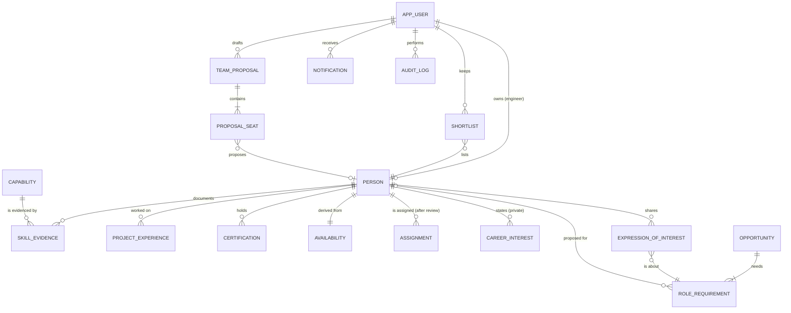
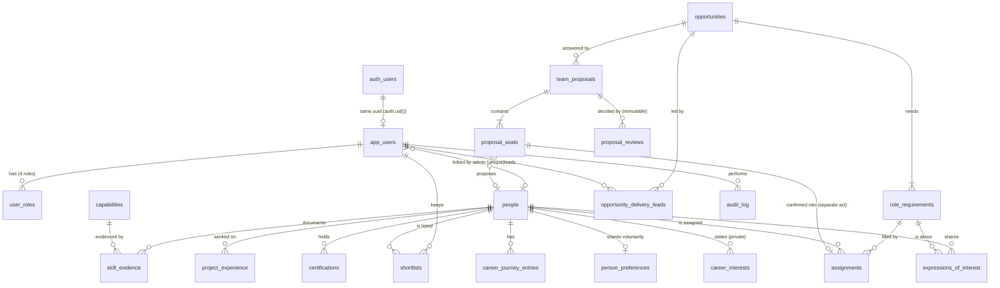

# 04 · Data & domain specification

**Contracts:** `src/domain/schemas.ts` (Zod, the single source of truth) · **Rules:** `src/domain/rules.ts` · **Fixtures:** `src/data/fixtures/*` · **Database (phase 2B.2, not connected to the app yet):** `supabase/migrations/0002`–`0009` + `supabase/seed.sql`. `0001` is the superseded draft, kept unchanged as history. See §7–§13.

> **All data in this repository is FICTIONAL.** People, clients, projects, dates and notifications were invented for the V4.2 prototype. Never import real employee records into fixtures, tests, screenshots or seeds.

## 1. Entity model



## 2. Entities

| Entity | Key fields | Notes / rules |
|---|---|---|
| **AppUser** | id, name, title, role (`staffing_lead` · `engineer` · *delivery_lead* · *admin*), personId | Phase 1 has two demo personas, Laura Gómez (staffing lead) and Ana Ruiz (engineer). |
| **Person** (professional profile / Talent Passport) | id, name, headline, discipline, location, country, yearsExperience, atSparqSince, languages, summary, topSkills (≤3), journey[], certifications[], workPreferences, passportGroups? | `topSkills` is a display choice, **not** a ranking. `passportGroups` lets the owner group expertise (Ana: Mobile engineering / Web & APIs / Applied AI). |
| **Capability** (skills catalogue) | id, name, group (`mobile`·`web`·`ai`·`data`·`cloud`·`quality`·`architecture`), aliases[] | Aliases power plain-language search ("native iOS" → `ios`). 37 capabilities. |
| **SkillEvidence** | id, personId, capabilityId, label, level (**evidence source**), detail, **verification**, verifiedBy?, verifiedOn? | Source (`level`: `professional` · `independent` · `training` · `emerging`) and verification (`self_reported` · `pending` · `verified`) are **separate concepts**. Owners can only create `self_reported` rows and cannot remove `verified` ones. Matching uses the best evidence per capability, verified first. See [08](08-authorization-and-evidence.md) §4. |
| **ProjectExperience** | id, personId, period, client, clientCategory, role, title, summary, tags[], highlights[], verification, verifiedBy?, verifiedOn? | `clientCategory` replaces the client name when "Hide client names" is on. The verification fields replace the old free-text `source`. |
| **Availability** | personId, availableFrom, status (`confirmed` · `pending`), currentProject, currentProjectEnds, deliveryLead, proposedFor? | Derived from assignments. "Available now" when `availableFrom ≤ today`. **Proposed ≠ assigned.** |
| **CareerInterests** | personId, interests{label: bool}, **shared**[] | **Private by default.** `shared` lists the selected labels the owner voluntarily disclosed to staffing; only those ever reach a staffing view. Interest in a specific opportunity is a separate concept (ExpressionOfInterest). `Person.workPreferences` is disclosed only when `workPreferencesShared`. |
| **Opportunity** | id, client, clientInitials, industry, name, short, description, status (`Staffing` · `Open` · `Upcoming`), kickoff, durationMonths, deliveryLead, capabilities[], interestNote, roles[] | |
| **RoleRequirement** | id, title, capabilities[], proposedPersonId | Open seat = no proposal. Proposals become assignments only after review. |
| **Shortlist** | ownerUserId → personIds[] | One per staffing lead. It's the same list everywhere (People preview, passport, Build a Team badge). |
| **TeamProposal / ProposalSeat** | proposal status, reviewer, note, seats with state `open` · `proposed` · `confirmed` | Phase 2 (Build a Team, Fill a Role). |
| **ExpressionOfInterest** | personId, roleRequirementId, note, sharedWithStaffing | Phase 2 (My Space). |
| **Notification** | audience/recipient, actor, text, href, when | Phase 1 uses static fixtures. |
| **AuditLog** | actor, action, subject, details | Phase 2: passport exports, shortlist changes, proposals, AI queries. |

## 3. Fictional dataset (phase 1)

- **Today:** `2026-11-24`, fixed by `Clock` in demo mode so every relative label is reproducible.
- **12 people:** Ana Ruiz (Mobile, the only fully curated passport), Lucía Fernández (AI), Javier Morales (Mobile/iOS), Ethan Brooks (Mobile/Android), Sofía Martínez (Frontend), Camila Duarte (Quality), Daniel Okafor (Backend), Mateo Silva (Backend/full-stack), Valentina Rojas (AI/ML), Marcus Chen (Architecture), Priya Nair (Data), Tomás Herrera (Cloud). Laura Gómez is a user with no passport.
- **Evidence:** 67 rows, extracted and normalized from V4.2's People, Compare, Passport and Planning sources.
- **4 opportunities:** Vela Bank (Staffing, Jan 12, 4 roles, 2 proposed: Lucía as AI and Camila as QA), Cobalt Mobility (Open, Jan 19, 3 roles), Terra Foods (Open, Feb 9, 3 roles), Nimbus Health (Upcoming, Mar 2, 2 roles). That makes **10 open seats**.
- **Availability:** Lucía now; Camila Dec 8; Sofía Dec 15; Ana and Javier Jan 5; Ethan Jan 19; Daniel, Mateo, Valentina and Marcus Feb 2; Priya Feb 16; Tomás Mar 2. Pending: Daniel, Mateo, Marcus, Priya, Tomás. This gives **6 people free within 60 days.**
- The V4.2 Home figures (4 · 10 · 6) are now **computed** from this data, not hard-coded. Unit tests assert both totals.

### Consistency fixes applied while normalizing V4.2 data

| V4.2 inconsistency | Resolution |
|---|---|
| Tomás free "Mar 1" in Planning vs "Mar 2" in People | Mar 2 everywhere; his project ends Feb 27. |
| Only Ana had a passport; other profiles showed "Full passport in this prototype: Ana Ruiz" | Every person has a passport built from their evidence and projects. Ana's keeps her curated groups, journey and certifications. |
| Mateo's React Native was "training" in People and "independent" in Compare | `independent` (he built an independent project). |
| Evidence used 3 levels on some screens and 5 on others | One canonical model: 4 levels plus "not documented". |
| Planning showed Ana "Proposed · Kestrel Travel" (a session draft) | Not in the base data. Proposals will come from TeamProposal records (phase 2). |

## 4. Business logic vs illustrative data

| Area | Real business logic (in `src/domain/rules.ts`, unit-tested) | Illustrative / fixture-only |
|---|---|---|
| Availability | "Available now / from <date>", confirmed vs pending, free-within-N-days, available-by cut-off | Dates themselves |
| Search | Alias-based interpretation of plain language into catalogue capabilities. Filtering to people with ≥1 documented match. Ordering is requirement-specific and evidence-aware: verified practical experience → professional first → experience needing confirmation → training or learning → availability → name. Each match reports its source **and** verification. **No score is returned.** | The 37-capability catalogue and its aliases |
| Passport | Grouping evidence by owner groups or by catalogue group. Strongest source per capability (`levelFor`). Need-specific summaries computed from evidence that keep verified and unconfirmed experience apart. | Ana's curated journey and certifications |
| Opportunities | Seat counts, open seats, "x of n seats proposed", deterministic requirement summary | Opportunity content |
| Shortlist | Per-user toggle, consistent across screens, authorized by the central policy | |
| Personal passport | Owner-only edits (summary, skills, experience, interests, what is shared) validated with Zod; skills and experience are always self-reported; verified evidence is locked | |
| Ask Sparq | Computed answers (January mobile availability, skill-combination questions, passport summaries and gaps), scoped to the signed-in user, evidence-aware, with a responsible-use policy | V4.2 example answers, always tagged "Illustrative example" |

## 5. Shared state model (replaces V4.2 `localStorage`)

| V4.2 key (`sti42.*`) | Phase 1 replacement | Phase 2 target |
|---|---|---|
| `shortlist` | Server action → `ShortlistRepository` (server memory, per user) | `shortlists` table + RLS |
| `passport`, `skillsAdded`, `ints` | Server actions → `TalentRepository` | `people`, `skill_evidence`, `career_interests` |
| `compare` | Zustand store in `sessionStorage` (UI selection only) | URL `?ids=&role=` + role context from the opportunity |
| `team`, `role` | Not built yet | `team_proposals`, `proposal_seats`, `role_requirements` |
| `me` | Not built yet | `expressions_of_interest` |

## 6. Repository contracts

`src/data/repositories/types.ts` defines `TalentRepository`, `OpportunityRepository`, `ShortlistRepository`, `DirectoryRepository` and `Clock`. All methods are async. Repositories are **unscoped**: server code reads people data through `scopedTalent(repos, actor)` (`src/data/repositories/scoped.ts`), which applies authorization and privacy. ESLint blocks importing fixtures outside `src/data` and `tests`, and blocks `src/app/**` from importing repositories at all. Details: [08](08-authorization-and-evidence.md).

---

# Database design (phase 2B.2)

> **Status:** designed and verified in PGlite (a real PostgreSQL engine, in-process) with emulated Supabase roles. **Not applied to any Supabase project, not used by the app** (the memory adapter is still the only implementation), **not declared production-ready.** Access rules and test evidence: [08](08-authorization-and-evidence.md) §7–§9.

## 7. Entity relationships (database)



20 tables in `public` (RLS on every one). `person_availability(as_of)` is a function, not a table (§11). The 17 tables of the old draft live on, locked, in schema `legacy_0001` (§12).

## 8. ID strategy

- **Every entity has a `uuid` primary key** (`gen_random_uuid()`); foreign keys are uuid (a test asserts no text foreign keys). Join tables use composite natural keys. `audit_log` uses a `bigint identity` (an ordered, append-only stream).
- **Slugs** (`people`, `capabilities`, `opportunities`, `role_requirements`; unique, `^[a-z0-9]+(-[a-z0-9]+)*$`) carry the readable ids the app and URLs use today (`ana-ruiz`, `ios`, `vela-bank`). The app adapter (phase 2C) maps slug ↔ uuid at the repository boundary; domain contracts do not change.
- **Identity:** `app_users.id` = `auth.users.id` (= `auth.uid()`). The link to a profile is `app_users.person_id` (unique), settable only by an administrator through `link_user_profile()`, never by the user.
- **Seed ids** are UUIDv5 of `kind:fixtureId`, so seeds are reproducible and re-runnable.

## 9. State transitions

**Team proposal** (`team_proposals.state`; valid transitions are enforced by a trigger for every role; API roles additionally cannot change state, version or submission stamps directly):

```
draft ──submit_proposal──▶ submitted ──review_proposal──▶ approved
  ▲                           │  ├────────────────────▶ declined
  │                           │  └────────────────────▶ changes_requested ──submit_proposal (version+1)──▶ submitted
  └── (author edits draft)    └──withdraw_proposal──▶ withdrawn      (withdraw also allowed from draft / changes_requested)
```

- Proposal ≠ assignment: `approved` creates **nothing**. A delivery lead then calls `confirm_assignment()` for **one seat at a time** (a second, explicit human act), which requires an approved proposal, a seat that proposes a person, and capacity (§11). Seat states are only `open | proposed`; "confirmed" exists as an `assignments` row, not as a seat state.
- Reviewer = the delivery lead **assigned to that opportunity**; never the author. The author cannot approve or confirm their own proposal; nobody confirms their own assignment.
- `proposal_reviews` rows are immutable, one per proposal version; a non-approval requires a note.

**Evidence / experience verification** (`verification`): `self_reported → pending → verified`, and `verified → self_reported` only by explicit revocation. Details in §10.

**Expression of interest:** `shared → withdrawn`, owner only; visible to staffing and the opportunity's delivery lead only while `shared`.

## 10. Evidence verification and privacy in the database

- `source` (`professional · independent · training · emerging`, who documented it) and `verification` (`self_reported · pending · verified`) are separate columns. `CHECK ((verification = 'verified') = (verified_by is not null and verified_at is not null))`.
- Owners can **insert only `self_reported`** rows (column grants exclude the verification columns, and the policy requires it), **cannot update or delete `verified`** rows, and cannot reach `verified_by/at/note`. Editing the content of a `pending` claim resets it to `self_reported`.
- Verification happens only in `request_evidence_verification` (owner: self_reported ⇄ pending) and `decide_evidence_verification` (verify / decline / revoke): the caller must be a delivery lead with a **working relationship** to the person (an assignment they lead, or a seat on a proposal for an opportunity they lead), never the person themselves. Every decision writes `audit_log`.
- **Privacy:** `career_interests.selected` / `shared_with_staffing` (deselecting clears the share; reselecting does **not** re-share). Staffing leads can read only rows that are both selected and shared; private rows are not returned at all (so they cannot be counted). Work preferences live in their own table (`person_preferences`), visible to staffing only while shared. Delivery leads and administrators have no access to interests or preferences. Interest in a specific role is a different entity (`expressions_of_interest`).

## 11. Assignment, allocation and availability rules

- `allocation` is a **fraction of one FTE** (`numeric(4,3)`, `0 < x ≤ 1`). An assignment occupies the half-open window `[starts_on, available_from)` (no end = open-ended).
- Overlapping assignments are allowed as long as the **peak total allocation never exceeds 1.0** (`assignment_capacity_guard`, serialized per person with an advisory lock). No exclusion constraint is used because overlap is legitimate.
- **Availability is derived, never stored** (`public.person_availability(as_of)`, security invoker so RLS applies): `available_from` is the earliest date ≥ `as_of` with load < 1.0; `free_capacity` = 1 − load there; `status = pending` while a releasing assignment's end date is unconfirmed; the proposed overlay (earliest submitted/approved proposal not yet confirmed) is information only and **never reduces availability**. Parity with the 12 fixtures' availability is a test.
- Assignments are created only by `confirm_assignment`; there is no table grant for writes.

## 12. Migration strategy (additive)

It cannot be proven whether `0001` was ever applied anywhere, so it is **not edited** (its sha256 is pinned in a test) and there is no destructive step.

| File | Purpose |
|---|---|
| `0001` | Original draft, unchanged. **Do not apply on its own.** |
| `0002` | Drops 0001's policies and two helper functions (they would resolve to the new tables), moves its 17 tables and rows to `legacy_0001` (RLS on, all privileges revoked, not exposed). |
| `0003`–`0005` | Identity/talent, staffing, audit (new tables, enums, constraints, integrity triggers). |
| `0006` | `private` helpers, integrity triggers, 13 privileged functions. |
| `0007` | `person_availability`. |
| `0008` | Revokes everything, RLS on every table, column-level grants, function grants, policies. |
| `0009` | Idempotent copy of safely-migratable legacy rows. Fails loudly on anything unexpected; **never upgrades trust** (legacy confirmations are kept only with a complete stamp), does not promote legacy assignments, in-review/approved proposals, availability, notifications or audit rows. |

Dropping `legacy_0001` is a later migration, after the copy is confirmed in a real environment. Tested on a populated legacy database (no row lost; re-run is a no-op).

## 13. Seed strategy

`supabase/seed.sql` is **generated** from the TypeScript fixtures (`npm run db:seed:generate` → `scripts/generate-seed.ts`, `src/data/seed/*`): deterministic, idempotent (`on conflict do nothing` / `where not exists`), fictional only. It contains 7 fictional users (staffing lead, 3 engineers, 2 delivery leads, 1 admin), 12 profiles, 37 capabilities, 67 evidence rows, 17 projects, the private/shared interests, 4 opportunities with 12 roles, delivery-lead assignments, the 11 current assignments, the Vela proposal (Lucía and Camila proposed), one shared expression of interest, and audit rows. Where the fixtures lack data the seed **invents** it and says so: assignment start dates (`2025-01-06`), verification stamps (`2026-11-12`), and partial dates (e.g. "2024") lose precision. A test compares seeded availability with the fixtures.

Remaining differences between domain and database (resolved by the phase 2C adapter): `level` → `source`; `verifiedBy` name → `verified_by` user id; the domain `UserRole` has 2 roles, the database 4; `allocation_pct` in 0001 → `allocation` fraction.

