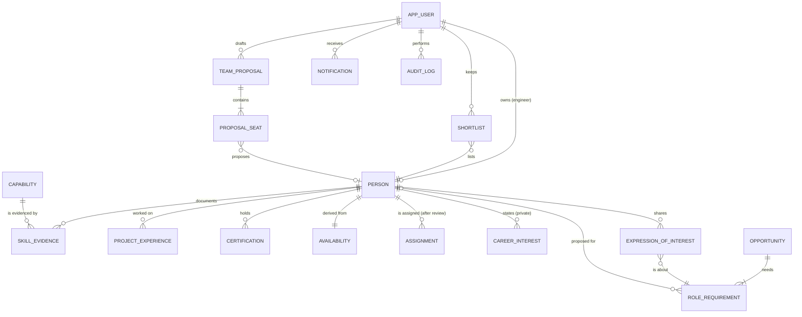

# 04 · Data & domain specification

**Contracts:** `src/domain/schemas.ts` (Zod, the single source of truth) · **Rules:** `src/domain/rules.ts` · **Fixtures:** `src/data/fixtures/*` · **Proposed DB:** `supabase/migrations/0001_initial_schema.sql`.

> **All data in this repository is FICTIONAL.** People, clients, projects, dates and notifications were invented for the V4.2 prototype. Never import real employee records into fixtures, tests, screenshots or seeds.

## 1. Entity model

## 2. Entities

| Entity | Key fields | Notes / rules |
|---|---|---|
| **AppUser** | id, name, title, role (`staffing_lead` · `engineer` · *delivery_lead* · *admin*), personId | Phase 1 has two demo personas, Laura Gómez (staffing lead) and Ana Ruiz (engineer). |
| **Person** (professional profile / Talent Passport) | id, name, headline, discipline, location, country, yearsExperience, atSparqSince, languages, summary, topSkills (≤3), journey[], certifications[], workPreferences, passportGroups? | `topSkills` is a display choice, **not** a ranking. `passportGroups` lets the owner group expertise (Ana: Mobile engineering / Web & APIs / Applied AI). |
| **Capability** (skills catalogue) | id, name, group (`mobile`·`web`·`ai`·`data`·`cloud`·`quality`·`architecture`), aliases[] | Aliases power plain-language search ("native iOS" → `ios`). 37 capabilities. |
| **SkillEvidence** | id, personId, capabilityId, label, level, detail, selfReported | Level is one of `professional` › `independent` › `training` › `emerging`. The strongest level per capability wins. Self-reported rows stay flagged until a delivery lead confirms them. |
| **ProjectExperience** | id, personId, period, client, clientCategory, role, title, summary, tags[], highlights[], source | `clientCategory` replaces the client name when "Hide client names" is on. `source` holds the confirmation trail. |
| **Availability** | personId, availableFrom, status (`confirmed` · `pending`), currentProject, currentProjectEnds, deliveryLead, proposedFor? | Derived from assignments. "Available now" when `availableFrom ≤ today`. **Proposed ≠ assigned.** |
| **CareerInterests** | personId, interests{label: bool} | Private to the person. Shown on the passport as "Looking forward to" only when the person has chosen them. |
| **Opportunity** | id, client, clientInitials, industry, name, short, description, status (`Staffing` · `Open` · `Upcoming`), kickoff, durationMonths, deliveryLead, capabilities[], interestNote, roles[] | |
| **RoleRequirement** | id, title, capabilities[], proposedPersonId | Open seat = no proposal. Proposals become assignments only after review. |
| **Shortlist** | ownerUserId → personIds[] | One per staffing lead. It's the same list everywhere (People preview, passport, Build a Team badge). |
| **TeamProposal / ProposalSeat** | proposal status, reviewer, note, seats with state `open` · `proposed` · `confirmed` | Phase 2 (Build a Team, Fill a Role). |
| **ExpressionOfInterest** | personId, roleRequirementId, note, sharedWithStaffing | Phase 2 (My Space). |
| **Notification** | audience/recipient, actor, text, href, when | Phase 1 uses static fixtures. |
| **AuditLog** | actor, action, subject, details | Phase 2: passport exports, shortlist changes, proposals, AI queries. |

## 3. Fictional dataset (phase 1)

- **Today:** `2026-11-24`, fixed by `Clock` in demo mode so every relative label is reproducible.
- **12 people:** Ana Ruiz (Mobile, the only fully curated passport), Lucía Fernández (AI), Javier Morales (Mobile/iOS), Ethan Brooks (Mobile/Android), Sofía Martínez (Frontend), Camila Duarte (Quality), Daniel Okafor (Backend), Mateo Silva (Backend/full-stack), Valentina Rojas (AI/ML), Marcus Chen (Architecture), Priya Nair (Data), Tomás Herrera (Cloud). Laura Gómez is a user with no passport.
- **Evidence:** 67 rows, extracted and normalized from V4.2's People, Compare, Passport and Planning sources.
- **4 opportunities:** Vela Bank (Staffing, Jan 12, 4 roles, 2 proposed: Lucía as AI and Camila as QA), Cobalt Mobility (Open, Jan 19, 3 roles), Terra Foods (Open, Feb 9, 3 roles), Nimbus Health (Upcoming, Mar 2, 2 roles). That makes **10 open seats**.
- **Availability:** Lucía now; Camila Dec 8; Sofía Dec 15; Ana and Javier Jan 5; Ethan Jan 19; Daniel, Mateo, Valentina and Marcus Feb 2; Priya Feb 16; Tomás Mar 2. Pending: Daniel, Mateo, Marcus, Priya, Tomás. This gives **6 people free within 60 days.**
- The V4.2 Home figures (4 · 10 · 6) are now **computed** from this data, not hard-coded. Unit tests assert both totals.

### Consistency fixes applied while normalizing V4.2 data

| V4.2 inconsistency | Resolution |
|---|---|
| Tomás free "Mar 1" in Planning vs "Mar 2" in People | Mar 2 everywhere; his project ends Feb 27. |
| Only Ana had a passport; other profiles showed "Full passport in this prototype: Ana Ruiz" | Every person has a passport built from their evidence and projects. Ana's keeps her curated groups, journey and certifications. |
| Mateo's React Native was "training" in People and "independent" in Compare | `independent` (he built an independent project). |
| Evidence used 3 levels on some screens and 5 on others | One canonical model: 4 levels plus "not documented". |
| Planning showed Ana "Proposed · Kestrel Travel" (a session draft) | Not in the base data. Proposals will come from TeamProposal records (phase 2). |

## 4. Business logic vs illustrative data

| Area | Real business logic (in `src/domain/rules.ts`, unit-tested) | Illustrative / fixture-only |
|---|---|---|
| Availability | "Available now / from <date>", confirmed vs pending, free-within-N-days, available-by cut-off | Dates themselves |
| Search | Alias-based interpretation of plain language into catalogue capabilities. Filtering to people with ≥1 documented match. Ordering: professional matches → any matches → independent over training → sooner availability. **No score is returned.** | The 37-capability catalogue and its aliases |
| Passport | Grouping evidence by owner groups or by catalogue group. Strongest level per capability. Need-specific summaries computed from evidence. | Ana's curated journey and certifications |
| Opportunities | Seat counts, open seats, "x of n seats proposed", deterministic requirement summary | Opportunity content |
| Shortlist | Per-user toggle, consistent across screens, role-checked server action | |
| Personal passport | Owner-only edits (summary, skills, experience, interests) validated with Zod, flagged self-reported | |
| Ask Sparq | Computed answers (January mobile availability, skill-combination questions, passport summaries and gaps) | V4.2 example answers, always tagged "Illustrative example" |

## 5. Shared state model (replaces V4.2 `localStorage`)

| V4.2 key (`sti42.*`) | Phase 1 replacement | Phase 2 target |
|---|---|---|
| `shortlist` | Server action → `ShortlistRepository` (server memory, per user) | `shortlists` table + RLS |
| `passport`, `skillsAdded`, `ints` | Server actions → `TalentRepository` | `people`, `skill_evidence`, `career_interests` |
| `compare` | Zustand store in `sessionStorage` (UI selection only) | URL `?ids=&role=` + role context from the opportunity |
| `team`, `role` | Not built yet | `team_proposals`, `proposal_seats`, `role_requirements` |
| `me` | Not built yet | `expressions_of_interest` |

## 6. Repository contracts

`src/data/repositories/types.ts` defines `TalentRepository`, `OpportunityRepository`, `ShortlistRepository`, `DirectoryRepository` and `Clock`. All methods are async. UI code imports them through `getRepositories()` (server-only). An ESLint rule blocks importing fixtures outside `src/data` and `tests`.
